# apps/web React component responsibility tree

## 문서 목적

주요 React 컴포넌트가 어떤 책임으로 나뉘고 조립되는지 보여주어, 새로운 화면 로직·상태·데이터 처리를 어느 계층에 배치할지 판단하는 데 참고한다.

이 문서는 전체 JSX 또는 DOM 구조를 열거하지 않는다. 상태를 개별적으로 나열하지는 않지만,
컴포넌트의 책임 구분을 통해 상태와 데이터 처리의 적절한 위치를 판단할 수 있도록 한다.
`apps/web/app/layout.tsx`의 `RootLayout`을 시작점으로 route, provider, runtime, container,
view와 독립 feature control 사이의 논리적 조립 관계를 정리한다.

## 표기 규칙과 범위

- `[Server]`: App Router가 Server Component로 렌더링하며 Client module graph에 포함되지 않은 컴포넌트
- `[Client]`: `"use client"` 경계를 선언했거나 해당 경계가 시작한 Client module graph에 포함된 컴포넌트
- `[conditional]`: 컴포넌트가 조건에 따라 출력 분기를 선택하거나 `null`을 반환하고, 또는 App Router가 런타임 상태에 따라 선택하는 UI
- `[dynamic]`: `next/dynamic`, `React.lazy`, `lazy()` 또는 동적 `import()`로 로드되는 컴포넌트
- `[slot: ...]`: `children`, slot, provider처럼 소스만으로 실제 자식을 하나로 확정할 수 없는 관계
- `[Route]`: App Router의 layout, page 또는 special UI 경계
- `[Provider]`: Context나 외부 store의 생명주기와 하위 사용 범위를 정의하는 경계
- `[Runtime]`: 화면과 독립적으로 bridge, realtime event 또는 진단 생명주기를 연결하는 경계
- `[Container]`: Query, mutation, local state, effect와 ViewModel을 조립하는 화면 경계
- `[View]`: 상위 container가 만든 props를 배치하는 대표 화면 경계
- `[Feature]`: 독립된 사용자 동작, 정책, 외부 상태 구독 또는 접근성 생명주기를 담당하는 경계
- `div`, `section`, `main`, `header` 등의 intrinsic HTML element는 제외했다.
- `next/link`의 `Link`처럼 프로젝트 외부에서 정의된 컴포넌트도 제외했다.
- 대표 `[View]` 경계는 props 중심이어도 container와 화면 책임의 분리를 보여주기 위해 포함한다.
- badge, avatar, item, notice, trigger, layout wrapper처럼 받은 값을 표시하거나 전달하기만 하는
  순수 표현용 내부 컴포넌트는 생략한다.
- 중간의 순수 표현용 컴포넌트를 생략한 관계는 실제 React parent-child 관계가 아니라 책임상
  상위 컴포넌트가 하위 기능을 조립하는 논리적 관계를 뜻한다.
- 조사 범위에서 `[dynamic]`에 해당하는 컴포넌트는 확인되지 않았다.
- 조건부로 렌더링되는 intrinsic element는 트리에 나타내지 않는다. 포함 대상인 프로젝트 컴포넌트
  호출이 조건식 안에 있으면 `[conditional]`로 표시한다.

## Route `/`

`RootLayout`의 `children`은 App Router가 현재 route segment에 맞게 제공한다. 이 route에서는 `HomePage`로 확정된다. `AppShell`은 `children`의 구체 타입을 알지 못하고 전달받아 렌더링한다.

```text
RootLayout [Server] [Route] (apps/web/app/layout.tsx)
└── AppShell [Client] [Container] (apps/web/components/app-shell.tsx)
    ├── NativeBridgeRuntime [Client] [Runtime] (apps/web/components/native-bridge-runtime.tsx)
    └── AppUpdateGate [Client] [Feature] [conditional] (apps/web/components/app-update-gate.tsx)
        ├── 조건: 필수 업데이트이면 안내 UI를 렌더링하고 전달받은 children은 렌더링하지 않음
        ├── AppInstallBanner [Client] [Feature] [conditional] (apps/web/components/app-install-banner.tsx)
        │   └── 조건: store URL이 없으면 null 반환
        ├── TemporaryLoginControl [Client] [Feature] [conditional] (apps/web/components/temporary-login-control.tsx)
        │   └── 조건: NODE_ENV가 production이 아닐 때만 렌더링
        └── children [slot: App Router가 route child를 제공]
            └── HomePage [Server] [Route] (apps/web/app/page.tsx)
```

`TemporaryLoginControl` 내부의 조건부 UI와 `HomePage`의 화면 요소는 intrinsic HTML element이므로 이 컴포넌트 트리에는 별도 자식으로 표시하지 않는다.

## Route `/chat`와 `/chat/[roomId]`

`ChatLayout`은 채팅 route segment의 공통 Query Client를 `ChatQueryProvider`에서 생성하고,
그 안에 `ChatRealtimeProvider`와 `ChatRoomReadStateProvider`를 배치한다. Read-state Provider는
방별 pending·in-flight·confirmed sequence를 route segment 수명 동안 유지하므로 방 화면이
unmount되어도 `/chat` 안의 route 이동에서는 예약된 보고가 유실되지 않는다. Provider는 짧은
bounded retry 이후 남은 pending을 focus·online·실시간 연결 복구 시 재개하고, 로그인 성공마다
transport의 인증 세대를 교체해 모든 탭에서 이전 사용자의 pending과 늦은 응답을 격리한다. 서버가
read-state PUT을 확정하면 기존 worker/leader-tab protocol을 통해 같은 인증 세대의 다른 탭에도
confirmation을 전달하고, 각 탭은 Room inbox query만 invalidate한다. 실시간 Provider는 STOMP Client를
직접 노출하지 않고 교체 가능한 transport를 제공한다. SharedWorker 지원 브라우저에서는 Worker가 STOMP Client를
소유하고, 미지원 단일 WebView에서는 Direct transport를 사용한다. 두 환경 모두 하위 채팅
컴포넌트의 사용 계약은 같다. 활성 Room의 message, room-event, read-receipt 세 topic은 같은
generation과 ordered delivery를 공유하고 Receipt 오류는 core message/Room event 적용과 분리한다.
목록에서는 `ChatPage`, 방 상세에서는 `ChatRoomPage`가 Provider의
`children` slot으로 전달된다.

```text
RootLayout [Server] [Route] (apps/web/app/layout.tsx)
└── AppShell [Client] [Container] (apps/web/components/app-shell.tsx)
    ├── NativeBridgeRuntime [Client] [Runtime] (apps/web/components/native-bridge-runtime.tsx)
    └── AppUpdateGate [Client] [Feature] [conditional] (apps/web/components/app-update-gate.tsx)
        ├── AppInstallBanner [Client] [Feature] [conditional] (apps/web/components/app-install-banner.tsx)
        ├── TemporaryLoginControl [Client] [Feature] [conditional: non-chat route, development] (apps/web/components/temporary-login-control.tsx)
        └── children [slot: App Router가 route child를 제공]
            └── ChatLayout [Server] [Route] (apps/web/app/chat/layout.tsx)
                └── ChatQueryProvider [Client] [Provider] (apps/web/components/chat-query-provider.tsx)
                    └── ChatRealtimeProvider [Client] [Provider] (apps/web/components/chat-realtime-provider.tsx)
                        ├── ChatRoomReadStateProvider [Client] [Provider] (apps/web/components/chat-room-read-state-provider.tsx)
                        │   └── children [slot: nested page를 제공]
                            ├── route /chat: ChatPage [Server] [Route] (apps/web/app/chat/page.tsx)
                            │   └── ChatRoomListScreen [Client] [Container] (apps/web/components/chat-room-list-screen.tsx)
                            │       └── ChatRoomListView [Client] [View] (apps/web/components/chat-room-list-view.tsx)
                            │           ├── ChatConnectionStatus [Client] [Feature] (apps/web/components/chat-connection-status.tsx)
                            │           ├── PublicRoomSearchForm [Client] [Feature] (apps/web/components/public-room-search-form.tsx)
                            │           ├── CreateChatRoomForm [Client] [Feature] [conditional] (apps/web/components/create-chat-room-form.tsx)
                            │           │   └── ChatRoomCategorySelector [Client] [Feature] (apps/web/components/chat-room-category-selector.tsx)
                            │           ├── ChatRoomCategoryBadges [Server-compatible] [View] [repeated] (apps/web/components/chat-room-category-badges.tsx)
                            │           └── ChatRoomListDetailDialog [Client] [Feature] [conditional] (apps/web/components/chat-room-list-detail-dialog.tsx)
                            │               └── JoinChatRoomControl [Client] [Feature] [conditional] (apps/web/components/join-chat-room-control.tsx)
                            ├── route /chat/creation-requests: RoomCreationRequestsPage [Server] [Route] (apps/web/app/chat/creation-requests/page.tsx)
                            │   └── RoomCreationRequestListScreen [Client] [Container] (apps/web/components/room-creation-request-list-screen.tsx)
                            │       └── RoomCreationRequestListView [Client] [View] (apps/web/components/room-creation-request-list-view.tsx)
                            ├── route /chat/creation-requests/[creationRequestId]: RoomCreationRequestPage [Server] [Route] (apps/web/app/chat/creation-requests/[creationRequestId]/page.tsx)
                            │   └── RoomCreationRequestScreen [Client] [Container] (apps/web/components/room-creation-request-screen.tsx)
                            │       └── RoomCreationRequestView [Client] [View] (apps/web/components/room-creation-request-view.tsx)
                            └── route /chat/[roomId]: ChatRoomPage [Server] [Route] (apps/web/app/chat/[roomId]/page.tsx)
                                └── ChatRoomScreen [Client] [Container] (apps/web/components/chat-room-screen.tsx)
                                    ├── ChatRoomView [Client] [View] (apps/web/components/chat-room-view.tsx)
                                    │   ├── ChatRoomEntryError [Server-compatible] [View] [conditional] (apps/web/components/chat-room-entry-error.tsx)
                                    │   └── ChatMessageViewport [Client] [Feature] (apps/web/components/chat-message-viewport.tsx)
                                    ├── ChatRoomSessionNotice [Client] [Feature] [conditional] (apps/web/components/chat-room-session-status.tsx)
                                    ├── ChatRealtimeSyncStatus [Client] [Feature] [conditional] (apps/web/components/chat-realtime-sync-status.tsx)
                                    ├── ChatRoomSessionControls [Client] [Feature] (apps/web/components/chat-room-session-controls.tsx)
                                    │   └── ChatMessageComposer [Client] [Feature] (apps/web/components/chat-message-composer.tsx)
                                    ├── ChatRoomScreenHeaderActions [Client] [View] (apps/web/components/chat-room-screen-overlays.tsx)
                                    └── ChatRoomScreenOverlay [Client] [View] [conditional, single] (apps/web/components/chat-room-screen-overlays.tsx)
                                        ├── ChatMessageActionsBottomSheet [Client] [Feature] [conditional] (apps/web/components/chat-message-actions-bottom-sheet.tsx)
                                        ├── ChatRoomMessageSearchDialog [Client] [Feature] [conditional] (apps/web/components/chat-room-message-search-dialog.tsx)
                                        └── ChatRoomMembershipDialog [Client] [Feature] [conditional] (apps/web/components/chat-room-membership-dialog.tsx)
                                            └── ChatRoomMembershipPanel [Client] [Container] (apps/web/components/chat-room-membership-panel.tsx)
                                                └── ChatRoomMembershipPanelView [Client] [View] (apps/web/components/chat-room-membership-panel.tsx)
                                                    ├── ChatRoomCategoryBadges [Server-compatible] [View] (apps/web/components/chat-room-category-badges.tsx)
                                                    └── ChatRoomSettingsControl [Client] [Container] [conditional] (apps/web/components/chat-room-settings-dialog.tsx)
                                                        └── ChatRoomSettingsControlView [Client] [View] (apps/web/components/chat-room-settings-dialog.tsx)
                                                            └── ChatRoomCategorySelector [Client] [Feature] [conditional] (apps/web/components/chat-room-category-selector.tsx)
                        ├── ChatRoomInboxRuntime [Client] [Runtime] (apps/web/components/chat-room-inbox-runtime.tsx)
                        │   └── ChatRoomInboxToastList [Client] [View] [conditional] (apps/web/components/chat-room-inbox-toast-list.tsx)
                        └── ChatRealtimeDiagnosticsPanel [Client] [Feature] [conditional, development] (apps/web/components/chat-realtime-diagnostics-panel.tsx)
```

`AppShell`은 `/chat`와 `/chat/[roomId]`에서 starter용 `site-header`를 렌더링하지 않고 chat
route가 자체 제품 header와 mobile-first surface를 소유하게 한다. 전역 하단 내비게이션은 아직
조립하지 않는다. 다른 route에서는 기존 site header와 development용 `TemporaryLoginControl`을
유지한다.

`ChatQueryProvider`가 렌더링하는 `ReactQueryDevtools`는 프로젝트 외부 컴포넌트이므로 트리에서
제외한다. Devtools 출력은 development 환경에서만 활성화된다. `ChatRealtimeSyncStatus`는
REST snapshot과 Worker buffer의 병합이 실패해 조치가 필요할 때만 header 안에 오류 UI를
렌더링하고, 정상·진행 중 상태에서는 `null`을 반환한다.

`ChatRoomInboxRuntime`은 개인 inbox 이벤트, Query 무효화, grouping과 timer를 담당하는 hook을
`ChatRoomInboxToastList`에 연결한다. Toast list는 현재 포커스된 탭에서 다른 Room의 CREATE
알림이 있을 때 만들어진 UI 전용 항목과 선택 callback만 받아 조건부로 렌더링한다. 이
Container/View 분리는 realtime event 처리와 toast 표현 책임의 경계이므로 트리에 유지한다.

`ChatRealtimeDiagnosticsPanel`은 development 환경에서만 우측 하단 trigger와 진단 패널을
렌더링한다. 패널이 열린 동안 SharedWorker 또는 direct transport의 구조화 진단 snapshot을
주기적으로 조회하며, 초기화와 전체 JSON 다운로드 기능을 제공한다.

`ChatRoomListScreen`은 목록 Query, 공개 방 검색·필터 상태, 참여 방 제외, 누적된 Room inbox의
전체·안읽음 로컬 필터, 생성 폼 disclosure와 Room 상세 selection·trigger focus 복원을 담당하는
hook을 `ChatRoomListView`에 연결한다.
`PublicRoomSearchForm`은 검색어 draft와 카테고리
선택을 전달하는 controlled 표현이며, 검색어 검증·적용 시점과 Query 조건은 container hook에 둔다.
`ChatRoomListDetailDialog`는 목록 snapshot을 Figma 기반 bottom sheet로 표현하고 참여 중인 Room의
입장 링크 또는 참여 가능한 Room의 `JoinChatRoomControl`을 조립한다. View 이하의 생성 폼과 참여
control은 각각 동작 hook을 호출하되, validation, mutation, 멱등성 key 재시도와 라우팅 구현은 JSX
밖에 둔다. 방 card, unread badge, avatar, notice와 pagination button은 이 책임 경계를 바꾸지 않는
순수 표현 요소라 생략한다.
`ChatRoomCategorySelector`는 생성·설정 UI가 공유하는 controlled 단일 선택 표현을 담당하고,
Backend enum 검증과 command payload 생성은 각 form model이 담당한다.
`ChatRoomCategoryBadges`는 공개·참여 Room card와 방 상세에서 같은 category label 표현을 공유한다.

`RoomCreationRequestListScreen`은 사용자의 신청 이력 infinite Query와 opaque cursor
pagination, `INVALID_CURSOR` one-shot 복구를 조립한다. `RoomCreationRequestListView`는
서버의 `requestedAt ASC`, `creationRequestId ASC` 순서를 변경하지 않고 상태별 신청
card와 상세 진입, 다음 page 적재를 표현한다.

`RoomCreationRequestScreen`은 `creationRequestId`별 상세 Query, 상태·오류 presentation과
명시적 새로고침을 조립해 `RoomCreationRequestView`에 전달한다. View는 신청의
`PENDING`·`APPROVED`·`REJECTED`·`CANCELED` 상태, 시각, 반려 사유와 승인된 Room
이동을 표현한다. 실시간 알림을 가정하지 않고, 사용자가 상세 화면에서 최신 상태를
직접 재조회할 수 있게 한다.

`ChatRoomScreen`은 화면에 필요한 controller와 ViewModel을 조립하는 container다.
`useChatRoomRealtimeExperience`는 Room session, Message History와 Read Receipt snapshot,
실시간 Query coordinator를 한 생명주기로 묶는다. Message History snapshot과 두 sequence 경계가
모두 준비된 뒤에만 실시간 event merge를 열고, 동기화 결과를 session view로 변환한다.
Receipt 오류는 기존 coordinator 경계에서 core message realtime과 분리한다.
`useChatRoomContentExperience`는 Room detail과 ACTIVE participant profile을 조회하고, realtime
snapshot을 읽음 진입 경험과 메시지 경험에 연결한다. Header, viewport ViewModel, history feedback과
Room 오류 복구 동작까지 UI가 바로 소비할 수 있는 content model로 반환한다.
Room 메시지 검색의 dialog disclosure, 적용된 query와 opaque cursor를 소유하는 독립 session,
검색 결과를 기준으로 조회한 Context window는 `useChatRoomMessageSearchExperience`가 함께 조립한다.
이 controller hook은 dialog 종료 시 Context와 검색 session을 정리하고 Room session이 비활성화되면
열린 검색을 닫는다. 검색 결과와 Context window는 일반 최신 timeline cache와 분리한다.
새 메시지는 고정된 검색 session에 자동 추가하지 않고, 실시간 UPDATE와 DELETE만 이미 로드된
검색 결과와 Context에 반영한다. 검색이나 Context 오류는 core message 수신·전송을 막지 않는다.
`useChatRoomParticipantProfiles`는 ACTIVE membership profile을 메시지 이력과 병렬로 조회하고,
`membershipId` cursor page를 끝까지 이어 Backend `displayName`을 제공한다. profile 조회 실패는 core
message 동작을 막지 않으며, 현재 ACTIVE 목록에 없는 과거 발신자는 `알 수 없는 참여자`로 표시한다.
`useChatRoomMessageHistoryData`는 최신 message Query와 과거 page load를 진입 위치 탐색용 history
snapshot으로 변환하여 Screen이 TanStack infinite page 구조를 직접 해석하지 않게 한다.
`useChatRoomMessageExperience`는 확정 Message History와 Outbox의 optimistic outgoing을 합치고,
확정된 `clientMessageId`를 Outbox에서 정리한다. 수정·삭제 mutation, 메시지 action sheet와
`useChatRoomMessagePresentation`도 같은 경험 경계에서 조립한다. presentation hook은 참여자 이름 map,
Read Receipt projection, 날짜·읽음 구분선 timeline과 viewport item을 만든다. receipt sync가 ready이며
Room detail의 현재 membership과 snapshot의 self membership이 일치할 때만 현재 확정 메시지에 읽은
인원 projection을 적용하고, message Query cache는 수정하지 않으며 양수인 읽은 인원만 표시한다.
Room 진입 시에는 `ChatRoomScreen`이 실시간 generation별 최초 receipt position을 고정하고, 읽음
경험 조립을 `useChatRoomReadExperience`에 위임한다. 이 hook은 읽음 구분선이 현재 message page에
없으면 제한된 수의 과거 page를 순차 조회한다. 탐색이 끝나기 전에는
viewport 초기 이동과 새 read-state 보고를 보류하며, 탐색 결과를 읽음 구분선 또는 안전한 fallback
초기 스크롤 목표로 변환한다. `ChatMessageViewport`는 이 목표가 준비된 뒤 virtualization index로
이동하고, 목표 위치가 정착된 이후에만 기존 focus·visibility·overlay 판정을 다시 적용한다. 자동
탐색 한도 또는 일시적 조회 실패에서는 viewport 상단 안내가 사용자 동작으로 다음 탐색 batch나
재시도를 시작하며, 읽음 위치가 결정되기 전까지 새 read-state 보고를 계속 보류한다.
같은 hook이 Room 종료·멤버십 상실을 read-state terminal 신호로 변환하고, receipt snapshot의 self
membership 불일치에서는 generation별 한 번만 Room detail과 receipt를 함께 재조회한다. 재참여 후 새
실시간 generation이 준비되면 재개 가능한 terminal 또는 sequence-ahead 상태만 다시 연다.
`ChatRoomView`는 container가 만든 UI 전용 ViewModel과 callback 또는 ReactNode slot을 배치하는
대표 View 경계이며 overlay 존재 여부를 read-state pause 신호로 viewport에 전달한다. 내부 header,
session indicator처럼 받은 값을 표시하는 내부 요소는 생략한다. `ChatRoomScreenHeaderActions`는 검색·방 정보
trigger를 배치하고, `ChatRoomScreenOverlay`는 검색, 참여자 정보, 메시지 action 순서의 단일 overlay 우선순위를
표현한다. `ChatMessageViewport`는 virtualization, scroll anchoring, 이전 이력 조회와
focus·visibility·최신 위치·overlay 상태를 반영한 read-state 보고 생명주기를 소유하므로 독립 Feature로 유지하고,
상단 loading/error, 이력 안내, 새 메시지 이동 버튼과 가상 row 선택 렌더링은
`chat-message-viewport-presentation.tsx`의 순수 표현 컴포넌트로 위임한다. 이 내부 표현 컴포넌트와
반복되는 개별 message item은 책임 경계를 새로 만들지 않으므로 트리에서는 생략한다.
Room detail 조회가 실패하면 `useChatRoomContentExperience`가 API 오류를 재시도 가능 여부와 사용자 안내 문구로
해석하고, `ChatRoomEntryError`가 일반 메시지 timeline 대신 공통 진입 오류 화면을 표시한다. 접근 종료·차단처럼
현재 화면에서 복구할 수 없는 오류는 채팅방 목록 이동을, 일시 조회 실패는 같은 자리의 명시적 재시도를 제공한다.

다른 탭 사용이나 연결 오류처럼 조치가 필요한 안내는 `ChatRoomSessionNotice`, snapshot 동기화
실패와 복구 동작은 `ChatRealtimeSyncStatus`가 담당한다. `ChatRoomSessionControls`는 해석된
session view와 message draft 동작을 조립하고 `ChatMessageComposer`는 입력·전송 및 키보드 동작을
담당한다. 메시지 수정·삭제 lifecycle과 transport command는 `useChatRoomMessageExperience`가 조립하고,
선택된 메시지의 접근 가능한 modal 동작은 `ChatMessageActionsBottomSheet`가 담당한다.
`useChatRoomOverlayExperience`는 방 정보·메시지 검색 disclosure, trigger focus 복원과
검색/멤버십/메시지 액션의 단일 overlay 우선순위를 조립한다. Screen은 이 controller가 제공한
header action과 overlay model을 View에 배치하고, `ChatRoomMembershipDialog` 안에서만
`ChatRoomMembershipPanel`을 mount한다. 세 overlay는 동시에 렌더링하지 않는다.
순수 overlay 선택 정책과 message history feedback 타입은 `.ts` ViewModel 모듈에 두어,
experience hook이 `.tsx` 표현 컴포넌트의 구현 타입을 역으로 참조하지 않게 한다.
`ChatRoomMembershipPanel`은 `useChatRoomMembershipPanel`이 조립한 controller를
`ChatRoomMembershipPanelView`에 전달하는 얇은 container다. controller hook은 Membership Query,
관리 mutation, 멱등성 key·재시도, 완료 라우팅을 소유하며 View에는 정규화된 목록 상태,
사용자 문구와 callback만 제공한다. View는 모든 ACTIVE membership에 profile 목록을 제공하고,
LEFT/BANNED 조회와 관리 control은 활성 OWNER에게만 표시한다.
`ChatRoomSettingsControl`은 `useChatRoomSettingsControl`의 controller를 설정 View에 전달하는 container다.
controller hook은 draft category, 부분 patch 계산, update-settings mutation과 멱등성 key 재시도를 소유하고,
View는 native Dialog의 focus·Escape·backdrop 동작과 form 표현만 담당한다.

## App Router special UI

다음 파일은 일반 route page가 아니라 root app segment에 연결된 App Router special file이다. 어떤 boundary와 runtime 상태에서 실제로 선택되는지는 Next.js가 관리하며, 프로젝트 소스에는 이들을 `RootLayout`이나 `AppShell`이 직접 JSX 자식으로 호출하는 관계가 없다. 따라서 아래 항목은 직접 부모를 추정하지 않고 독립된 framework-managed branch로 표시한다.

```text
Loading [Server] [Route] [conditional: loading state]
(apps/web/app/loading.tsx)

ErrorPage [Client] [Route] [conditional: uncaught route error]
(apps/web/app/error.tsx)

NotFound [Server] [Route] [conditional: unmatched route 또는 notFound()]
(apps/web/app/not-found.tsx)
```

세 special component 모두 프로젝트에서 정의한 다른 React 컴포넌트를 렌더링하지 않는다.

## 전체 component dependency graph

실선은 주요 책임 경계 사이의 논리적 조립 관계다. 중간의 순수 표현용 컴포넌트는 생략될 수
있으므로 실선이 항상 실제 React parent-child 관계를 뜻하지는 않는다. 점선은 App Router 또는
`children` slot이 런타임에 결정하는 관계다.

```mermaid
flowchart TD
    RootLayout["RootLayout [Server] [Route]<br/>apps/web/app/layout.tsx"]
    AppShell["AppShell [Client] [Container]<br/>apps/web/components/app-shell.tsx"]
    NativeBridgeRuntime["NativeBridgeRuntime [Client] [Runtime]<br/>apps/web/components/native-bridge-runtime.tsx"]
    AppUpdateGate["AppUpdateGate [Client] [Feature] [conditional]<br/>apps/web/components/app-update-gate.tsx"]
    AppInstallBanner["AppInstallBanner [Client] [Feature] [conditional]<br/>apps/web/components/app-install-banner.tsx"]
    ChildrenSlot["children slot<br/>App Router가 실제 자식을 결정"]

    HomePage["HomePage [Server] [Route]<br/>apps/web/app/page.tsx"]
    TemporaryLoginControl["TemporaryLoginControl [Client] [Feature] [conditional]<br/>apps/web/components/temporary-login-control.tsx"]

    ChatLayout["ChatLayout [Server] [Route]<br/>apps/web/app/chat/layout.tsx"]
    ChatQueryProvider["ChatQueryProvider [Client] [Provider]<br/>apps/web/components/chat-query-provider.tsx"]
    ChatRealtimeProvider["ChatRealtimeProvider [Client] [Provider]<br/>apps/web/components/chat-realtime-provider.tsx"]
    ChatRoomReadStateProvider["ChatRoomReadStateProvider [Client] [Provider]<br/>apps/web/components/chat-room-read-state-provider.tsx"]
    ChatRealtimeDiagnosticsPanel["ChatRealtimeDiagnosticsPanel [Client] [Feature] [conditional, development]<br/>apps/web/components/chat-realtime-diagnostics-panel.tsx"]
    ChatRoomInboxRuntime["ChatRoomInboxRuntime [Client] [Runtime]<br/>apps/web/components/chat-room-inbox-runtime.tsx"]
    ChatRoomInboxToastList["ChatRoomInboxToastList [Client] [View] [conditional]<br/>apps/web/components/chat-room-inbox-toast-list.tsx"]
    ChatChildrenSlot["chat children slot<br/>nested page를 제공"]
    ChatPage["ChatPage [Server] [Route]<br/>apps/web/app/chat/page.tsx"]
    ChatRoomListScreen["ChatRoomListScreen [Client] [Container]<br/>apps/web/components/chat-room-list-screen.tsx"]
    ChatRoomListView["ChatRoomListView [Client] [View]<br/>apps/web/components/chat-room-list-view.tsx"]
    ChatRoomListDetailDialog["ChatRoomListDetailDialog [Client] [Feature] [conditional]<br/>apps/web/components/chat-room-list-detail-dialog.tsx"]
    PublicRoomSearchForm["PublicRoomSearchForm [Client] [Feature]<br/>apps/web/components/public-room-search-form.tsx"]
    CreateChatRoomForm["CreateChatRoomForm [Client] [Feature] [conditional]<br/>apps/web/components/create-chat-room-form.tsx"]
    ChatRoomCategorySelector["ChatRoomCategorySelector [Client] [Feature]<br/>apps/web/components/chat-room-category-selector.tsx"]
    ChatRoomCategoryBadges["ChatRoomCategoryBadges [Server-compatible] [View]<br/>apps/web/components/chat-room-category-badges.tsx"]
    JoinChatRoomControl["JoinChatRoomControl [Client] [Feature] [repeated]<br/>apps/web/components/join-chat-room-control.tsx"]
    ChatConnectionStatus["ChatConnectionStatus [Client] [Feature]<br/>apps/web/components/chat-connection-status.tsx"]
    RoomCreationRequestsPage["RoomCreationRequestsPage [Server] [Route]<br/>apps/web/app/chat/creation-requests/page.tsx"]
    RoomCreationRequestListScreen["RoomCreationRequestListScreen [Client] [Container]<br/>apps/web/components/room-creation-request-list-screen.tsx"]
    RoomCreationRequestListView["RoomCreationRequestListView [Client] [View]<br/>apps/web/components/room-creation-request-list-view.tsx"]
    RoomCreationRequestPage["RoomCreationRequestPage [Server] [Route]<br/>apps/web/app/chat/creation-requests/[creationRequestId]/page.tsx"]
    RoomCreationRequestScreen["RoomCreationRequestScreen [Client] [Container]<br/>apps/web/components/room-creation-request-screen.tsx"]
    RoomCreationRequestView["RoomCreationRequestView [Client] [View]<br/>apps/web/components/room-creation-request-view.tsx"]
    ChatRoomPage["ChatRoomPage [Server] [Route]<br/>apps/web/app/chat/[roomId]/page.tsx"]
    ChatRoomScreen["ChatRoomScreen [Client] [Container]<br/>apps/web/components/chat-room-screen.tsx"]
    ChatRoomView["ChatRoomView [Client] [View]<br/>apps/web/components/chat-room-view.tsx"]
    ChatRoomEntryError["ChatRoomEntryError [Server-compatible] [View] [conditional]<br/>apps/web/components/chat-room-entry-error.tsx"]
    ChatMessageViewport["ChatMessageViewport [Client] [Feature]<br/>apps/web/components/chat-message-viewport.tsx"]
    ChatRoomScreenHeaderActions["ChatRoomScreenHeaderActions [Client] [View]<br/>apps/web/components/chat-room-screen-overlays.tsx"]
    ChatRoomScreenOverlay["ChatRoomScreenOverlay [Client] [View] [conditional, single]<br/>apps/web/components/chat-room-screen-overlays.tsx"]
    ChatMessageActionsBottomSheet["ChatMessageActionsBottomSheet [Client] [Feature] [conditional, single]<br/>apps/web/components/chat-message-actions-bottom-sheet.tsx"]
    ChatRoomMessageSearchDialog["ChatRoomMessageSearchDialog [Client] [Feature] [conditional]<br/>apps/web/components/chat-room-message-search-dialog.tsx"]
    ChatRoomMembershipDialog["ChatRoomMembershipDialog [Client] [Feature] [conditional]<br/>apps/web/components/chat-room-membership-dialog.tsx"]
    ChatRoomMembershipPanel["ChatRoomMembershipPanel [Client] [Container]<br/>apps/web/components/chat-room-membership-panel.tsx"]
    ChatRoomMembershipPanelView["ChatRoomMembershipPanelView [Client] [View]<br/>apps/web/components/chat-room-membership-panel.tsx"]
    ChatRoomSettingsControl["ChatRoomSettingsControl [Client] [Container] [conditional]<br/>apps/web/components/chat-room-settings-dialog.tsx"]
    ChatRoomSettingsControlView["ChatRoomSettingsControlView [Client] [View]<br/>apps/web/components/chat-room-settings-dialog.tsx"]
    ChatRealtimeSyncStatus["ChatRealtimeSyncStatus [Client] [Feature] [conditional]<br/>apps/web/components/chat-realtime-sync-status.tsx"]
    ChatRoomSessionControls["ChatRoomSessionControls [Client] [Feature]<br/>apps/web/components/chat-room-session-controls.tsx"]
    ChatRoomSessionNotice["ChatRoomSessionNotice [Client] [Feature] [conditional]<br/>apps/web/components/chat-room-session-status.tsx"]
    ChatMessageComposer["ChatMessageComposer [Client] [Feature]<br/>apps/web/components/chat-message-composer.tsx"]

    SpecialBoundary["App Router root-segment special UI<br/>framework-managed; direct JSX parent 미확정"]
    Loading["Loading [Server] [Route] [conditional]<br/>apps/web/app/loading.tsx"]
    ErrorPage["ErrorPage [Client] [Route] [conditional]<br/>apps/web/app/error.tsx"]
    NotFound["NotFound [Server] [Route] [conditional]<br/>apps/web/app/not-found.tsx"]

    RootLayout --> AppShell
    AppShell --> NativeBridgeRuntime
    AppShell -->|"update policy branch"| AppUpdateGate
    AppUpdateGate -->|"component output conditional"| AppInstallBanner
    AppUpdateGate -->|"non-chat route, development only"| TemporaryLoginControl
    AppUpdateGate --> ChildrenSlot

    ChildrenSlot -. "route /" .-> HomePage

    ChildrenSlot -. "route /chat" .-> ChatLayout
    ChatLayout --> ChatQueryProvider
    ChatQueryProvider --> ChatRealtimeProvider
    ChatRealtimeProvider --> ChatRoomReadStateProvider
    ChatRoomReadStateProvider --> ChatChildrenSlot
    ChatRealtimeProvider --> ChatRoomInboxRuntime
    ChatRealtimeProvider -->|"development only"| ChatRealtimeDiagnosticsPanel
    ChatRoomInboxRuntime -->|"conditional toast"| ChatRoomInboxToastList
    ChatChildrenSlot -. "route /chat" .-> ChatPage
    ChatChildrenSlot -. "route /chat/creation-requests" .-> RoomCreationRequestsPage
    ChatChildrenSlot -. "route /chat/creation-requests/[creationRequestId]" .-> RoomCreationRequestPage
    ChatChildrenSlot -. "route /chat/[roomId]" .-> ChatRoomPage
    ChatPage --> ChatRoomListScreen
    ChatRoomListScreen --> ChatRoomListView
    ChatRoomListView --> ChatConnectionStatus
    ChatRoomListView --> PublicRoomSearchForm
    ChatRoomListView -->|"conditional create form"| CreateChatRoomForm
    CreateChatRoomForm --> ChatRoomCategorySelector
    ChatRoomListView -->|"room cards"| ChatRoomCategoryBadges
    ChatRoomListView -->|"selected room detail"| ChatRoomListDetailDialog
    ChatRoomListDetailDialog -->|"available room action"| JoinChatRoomControl
    RoomCreationRequestsPage --> RoomCreationRequestListScreen
    RoomCreationRequestListScreen --> RoomCreationRequestListView
    RoomCreationRequestPage --> RoomCreationRequestScreen
    RoomCreationRequestScreen --> RoomCreationRequestView
    ChatRoomPage --> ChatRoomScreen
    ChatRoomScreen --> ChatRoomView
    ChatRoomView -->|"room detail error"| ChatRoomEntryError
    ChatRoomView --> ChatMessageViewport
    ChatRoomScreen -->|"actionable session state"| ChatRoomSessionNotice
    ChatRoomScreen -->|"snapshot sync recovery"| ChatRealtimeSyncStatus
    ChatRoomScreen -->|"message draft and send"| ChatRoomSessionControls
    ChatRoomSessionControls --> ChatMessageComposer
    ChatRoomScreen -->|"header controls"| ChatRoomScreenHeaderActions
    ChatRoomScreen -->|"single overlay priority"| ChatRoomScreenOverlay
    ChatRoomScreenOverlay -->|"one selected message"| ChatMessageActionsBottomSheet
    ChatRoomScreenOverlay -->|"isolated Room message search and context windows"| ChatRoomMessageSearchDialog
    ChatRoomScreenOverlay -->|"room info disclosure"| ChatRoomMembershipDialog
    ChatRoomMembershipDialog --> ChatRoomMembershipPanel
    ChatRoomMembershipPanel --> ChatRoomMembershipPanelView
    ChatRoomMembershipPanelView --> ChatRoomCategoryBadges
    ChatRoomMembershipPanelView -->|"active OWNER only"| ChatRoomSettingsControl
    ChatRoomSettingsControl --> ChatRoomSettingsControlView
    ChatRoomSettingsControlView -->|"conditional settings dialog"| ChatRoomCategorySelector

    SpecialBoundary -. "loading state" .-> Loading
    SpecialBoundary -. "error state" .-> ErrorPage
    SpecialBoundary -. "not-found state" .-> NotFound

    classDef server fill:#e8f1ff,stroke:#2563eb,color:#172554;
    classDef client fill:#fff1e6,stroke:#ea580c,color:#431407;
    classDef framework fill:#f3f4f6,stroke:#6b7280,color:#111827,stroke-dasharray:5 5;

    class RootLayout,HomePage,ChatLayout,ChatPage,RoomCreationRequestsPage,RoomCreationRequestPage,ChatRoomPage,Loading,NotFound server;
    class AppShell,NativeBridgeRuntime,AppUpdateGate,AppInstallBanner,TemporaryLoginControl,ChatQueryProvider,ChatRealtimeProvider,ChatRoomReadStateProvider,ChatRealtimeDiagnosticsPanel,ChatRoomInboxRuntime,ChatRoomInboxToastList,ChatRoomListScreen,ChatRoomListView,PublicRoomSearchForm,CreateChatRoomForm,ChatRoomCategorySelector,JoinChatRoomControl,ChatConnectionStatus,RoomCreationRequestListScreen,RoomCreationRequestListView,RoomCreationRequestScreen,RoomCreationRequestView,ChatRoomScreen,ChatRoomView,ChatMessageViewport,ChatRoomScreenHeaderActions,ChatRoomScreenOverlay,ChatMessageActionsBottomSheet,ChatRoomMessageSearchDialog,ChatRoomMembershipDialog,ChatRoomMembershipPanel,ChatRoomSettingsControl,ChatRealtimeSyncStatus,ChatRoomSessionControls,ChatRoomSessionNotice,ChatMessageComposer,ErrorPage client;
    class ChatRoomEntryError server;
    class ChildrenSlot,ChatChildrenSlot,SpecialBoundary framework;
```


