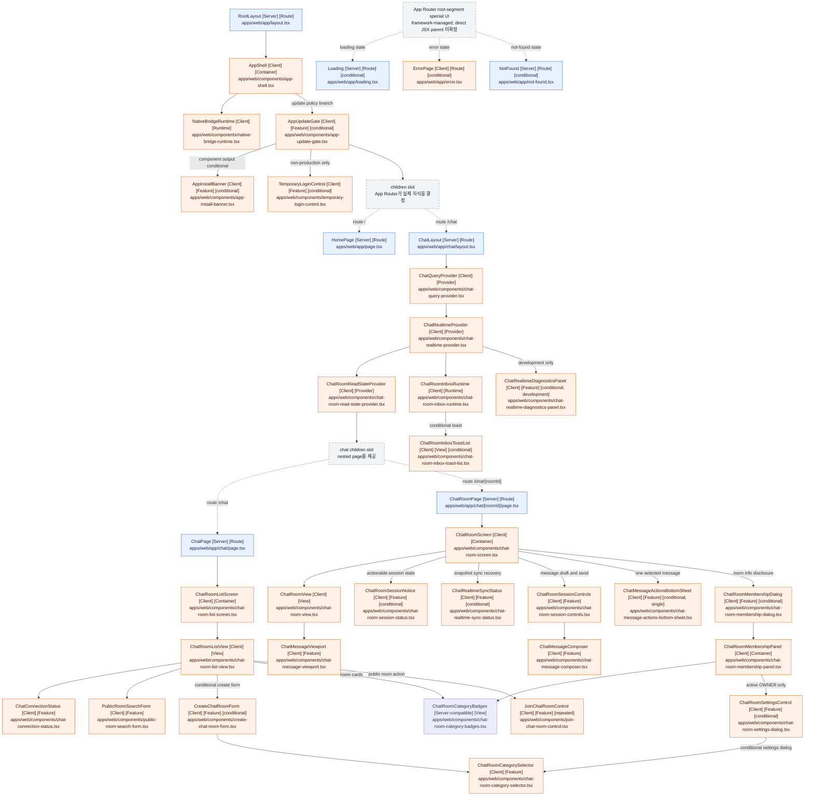

# apps/web React component responsibility tree

## 문서 목적

주요 React 컴포넌트가 어떤 책임으로 나뉘고 조립되는지 보여주어, 새로운 화면 로직·상태·데이터 처리를 어느 계층에 배치할지 판단하는 데 참고한다.

이 문서는 전체 JSX 또는 DOM 구조를 열거하지 않는다. 상태를 개별적으로 나열하지는 않지만,
컴포넌트의 책임 구분을 통해 상태와 데이터 처리의 적절한 위치를 판단할 수 있도록 한다.
`apps/web/app/layout.tsx`의 `RootLayout`을 시작점으로 route, provider, runtime, container,
view와 독립 feature control 사이의 논리적 조립 관계를 정리한다.

## 표기 규칙과 범위

- `[Server]`: App Router가 Server Component로 렌더링하며 Client module graph에 포함되지 않은 컴포넌트
- `[Client]`: `"use client"` 경계를 선언했거나 해당 경계가 시작한 Client module graph에 포함된 컴포넌트
- `[conditional]`: 컴포넌트가 조건에 따라 출력 분기를 선택하거나 `null`을 반환하고, 또는 App Router가 런타임 상태에 따라 선택하는 UI
- `[dynamic]`: `next/dynamic`, `React.lazy`, `lazy()` 또는 동적 `import()`로 로드되는 컴포넌트
- `[slot: ...]`: `children`, slot, provider처럼 소스만으로 실제 자식을 하나로 확정할 수 없는 관계
- `[Route]`: App Router의 layout, page 또는 special UI 경계
- `[Provider]`: Context나 외부 store의 생명주기와 하위 사용 범위를 정의하는 경계
- `[Runtime]`: 화면과 독립적으로 bridge, realtime event 또는 진단 생명주기를 연결하는 경계
- `[Container]`: Query, mutation, local state, effect와 ViewModel을 조립하는 화면 경계
- `[View]`: 상위 container가 만든 props를 배치하는 대표 화면 경계
- `[Feature]`: 독립된 사용자 동작, 정책, 외부 상태 구독 또는 접근성 생명주기를 담당하는 경계
- `div`, `section`, `main`, `header` 등의 intrinsic HTML element는 제외했다.
- `next/link`의 `Link`처럼 프로젝트 외부에서 정의된 컴포넌트도 제외했다.
- 대표 `[View]` 경계는 props 중심이어도 container와 화면 책임의 분리를 보여주기 위해 포함한다.
- badge, avatar, item, notice, trigger, layout wrapper처럼 받은 값을 표시하거나 전달하기만 하는
  순수 표현용 내부 컴포넌트는 생략한다.
- 중간의 순수 표현용 컴포넌트를 생략한 관계는 실제 React parent-child 관계가 아니라 책임상
  상위 컴포넌트가 하위 기능을 조립하는 논리적 관계를 뜻한다.
- 조사 범위에서 `[dynamic]`에 해당하는 컴포넌트는 확인되지 않았다.
- 조건부로 렌더링되는 intrinsic element는 트리에 나타내지 않는다. 포함 대상인 프로젝트 컴포넌트
  호출이 조건식 안에 있으면 `[conditional]`로 표시한다.

## Route `/`

`RootLayout`의 `children`은 App Router가 현재 route segment에 맞게 제공한다. 이 route에서는 `HomePage`로 확정된다. `AppShell`은 `children`의 구체 타입을 알지 못하고 전달받아 렌더링한다.

```text
RootLayout [Server] [Route] (apps/web/app/layout.tsx)
└── AppShell [Client] [Container] (apps/web/components/app-shell.tsx)
    ├── NativeBridgeRuntime [Client] [Runtime] (apps/web/components/native-bridge-runtime.tsx)
    └── AppUpdateGate [Client] [Feature] [conditional] (apps/web/components/app-update-gate.tsx)
        ├── 조건: 필수 업데이트이면 안내 UI를 렌더링하고 전달받은 children은 렌더링하지 않음
        ├── AppInstallBanner [Client] [Feature] [conditional] (apps/web/components/app-install-banner.tsx)
        │   └── 조건: store URL이 없으면 null 반환
        ├── TemporaryLoginControl [Client] [Feature] [conditional] (apps/web/components/temporary-login-control.tsx)
        │   └── 조건: NODE_ENV가 production이 아닐 때만 렌더링
        └── children [slot: App Router가 route child를 제공]
            └── HomePage [Server] [Route] (apps/web/app/page.tsx)
```

`TemporaryLoginControl` 내부의 조건부 UI와 `HomePage`의 화면 요소는 intrinsic HTML element이므로 이 컴포넌트 트리에는 별도 자식으로 표시하지 않는다.

## Route `/chat`와 `/chat/[roomId]`

`ChatLayout`은 채팅 route segment의 공통 Query Client를 `ChatQueryProvider`에서 생성하고,
그 안에 `ChatRealtimeProvider`와 `ChatRoomReadStateProvider`를 배치한다. Read-state Provider는
방별 pending·in-flight·confirmed sequence를 route segment 수명 동안 유지하므로 방 화면이
unmount되어도 `/chat` 안의 route 이동에서는 예약된 보고가 유실되지 않는다. 실시간 Provider는 STOMP Client를 직접 노출하지
않고 교체 가능한 transport를 제공한다. SharedWorker 지원 브라우저에서는 Worker가 STOMP Client를
소유하고, 미지원 단일 WebView에서는 Direct transport를 사용한다. 두 환경 모두 하위 채팅
컴포넌트의 사용 계약은 같다. 목록에서는 `ChatPage`, 방 상세에서는 `ChatRoomPage`가 Provider의
`children` slot으로 전달된다.

```text
RootLayout [Server] [Route] (apps/web/app/layout.tsx)
└── AppShell [Client] [Container] (apps/web/components/app-shell.tsx)
    ├── NativeBridgeRuntime [Client] [Runtime] (apps/web/components/native-bridge-runtime.tsx)
    └── AppUpdateGate [Client] [Feature] [conditional] (apps/web/components/app-update-gate.tsx)
        ├── AppInstallBanner [Client] [Feature] [conditional] (apps/web/components/app-install-banner.tsx)
        ├── TemporaryLoginControl [Client] [Feature] [conditional] (apps/web/components/temporary-login-control.tsx)
        └── children [slot: App Router가 route child를 제공]
            └── ChatLayout [Server] [Route] (apps/web/app/chat/layout.tsx)
                └── ChatQueryProvider [Client] [Provider] (apps/web/components/chat-query-provider.tsx)
                    └── ChatRealtimeProvider [Client] [Provider] (apps/web/components/chat-realtime-provider.tsx)
                        ├── ChatRoomReadStateProvider [Client] [Provider] (apps/web/components/chat-room-read-state-provider.tsx)
                        │   └── children [slot: nested page를 제공]
                            ├── route /chat: ChatPage [Server] [Route] (apps/web/app/chat/page.tsx)
                            │   └── ChatRoomListScreen [Client] [Container] (apps/web/components/chat-room-list-screen.tsx)
                            │       └── ChatRoomListView [Client] [View] (apps/web/components/chat-room-list-view.tsx)
                            │           ├── ChatConnectionStatus [Client] [Feature] (apps/web/components/chat-connection-status.tsx)
                            │           ├── PublicRoomSearchForm [Client] [Feature] (apps/web/components/public-room-search-form.tsx)
                            │           ├── CreateChatRoomForm [Client] [Feature] [conditional] (apps/web/components/create-chat-room-form.tsx)
                            │           │   └── ChatRoomCategorySelector [Client] [Feature] (apps/web/components/chat-room-category-selector.tsx)
                            │           ├── ChatRoomCategoryBadges [Server-compatible] [View] [repeated] (apps/web/components/chat-room-category-badges.tsx)
                            │           └── JoinChatRoomControl [Client] [Feature] [repeated] (apps/web/components/join-chat-room-control.tsx)
                            └── route /chat/[roomId]: ChatRoomPage [Server] [Route] (apps/web/app/chat/[roomId]/page.tsx)
                                └── ChatRoomScreen [Client] [Container] (apps/web/components/chat-room-screen.tsx)
                                    ├── ChatRoomView [Client] [View] (apps/web/components/chat-room-view.tsx)
                                    │   └── ChatMessageViewport [Client] [Feature] (apps/web/components/chat-message-viewport.tsx)
                                    ├── ChatRoomSessionNotice [Client] [Feature] [conditional] (apps/web/components/chat-room-session-status.tsx)
                                    ├── ChatRealtimeSyncStatus [Client] [Feature] [conditional] (apps/web/components/chat-realtime-sync-status.tsx)
                                    ├── ChatRoomSessionControls [Client] [Feature] (apps/web/components/chat-room-session-controls.tsx)
                                    │   └── ChatMessageComposer [Client] [Feature] (apps/web/components/chat-message-composer.tsx)
                                    ├── ChatMessageActionsBottomSheet [Client] [Feature] [conditional, single] (apps/web/components/chat-message-actions-bottom-sheet.tsx)
                                    └── ChatRoomMembershipDialog [Client] [Feature] [conditional] (apps/web/components/chat-room-membership-dialog.tsx)
                                        └── ChatRoomMembershipPanel [Client] [Container] (apps/web/components/chat-room-membership-panel.tsx)
                                            ├── ChatRoomCategoryBadges [Server-compatible] [View] (apps/web/components/chat-room-category-badges.tsx)
                                            └── ChatRoomSettingsControl [Client] [Feature] [conditional] (apps/web/components/chat-room-settings-dialog.tsx)
                                                └── ChatRoomCategorySelector [Client] [Feature] [conditional] (apps/web/components/chat-room-category-selector.tsx)
                        ├── ChatRoomInboxRuntime [Client] [Runtime] (apps/web/components/chat-room-inbox-runtime.tsx)
                        │   └── ChatRoomInboxToastList [Client] [View] [conditional] (apps/web/components/chat-room-inbox-toast-list.tsx)
                        └── ChatRealtimeDiagnosticsPanel [Client] [Feature] [conditional, development] (apps/web/components/chat-realtime-diagnostics-panel.tsx)
```

`ChatQueryProvider`가 렌더링하는 `ReactQueryDevtools`는 프로젝트 외부 컴포넌트이므로 트리에서
제외한다. Devtools 출력은 development 환경에서만 활성화된다. `ChatRealtimeSyncStatus`는
REST snapshot과 Worker buffer의 병합이 실패해 조치가 필요할 때만 header 안에 오류 UI를
렌더링하고, 정상·진행 중 상태에서는 `null`을 반환한다.

`ChatRoomInboxRuntime`은 개인 inbox 이벤트, Query 무효화, grouping과 timer를 담당하는 hook을
`ChatRoomInboxToastList`에 연결한다. Toast list는 현재 포커스된 탭에서 다른 Room의 CREATE
알림이 있을 때 만들어진 UI 전용 항목과 선택 callback만 받아 조건부로 렌더링한다. 이
Container/View 분리는 realtime event 처리와 toast 표현 책임의 경계이므로 트리에 유지한다.

`ChatRealtimeDiagnosticsPanel`은 development 환경에서만 우측 하단 trigger와 진단 패널을
렌더링한다. 패널이 열린 동안 SharedWorker 또는 direct transport의 구조화 진단 snapshot을
주기적으로 조회하며, 초기화와 전체 JSON 다운로드 기능을 제공한다.

`ChatRoomListScreen`은 목록 Query, 공개 방 검색·필터 상태, 참여 방 제외와 생성 폼 disclosure를
담당하는 hook을 `ChatRoomListView`에 연결한다. `PublicRoomSearchForm`은 검색어 draft와 카테고리
선택을 전달하는 controlled 표현이며, 검색어 검증·적용 시점과 Query 조건은 container hook에 둔다.
View 이하의 생성 폼과 참여 control은 각각 동작 hook을 호출하되, validation, mutation, 멱등성 key
재시도와 라우팅 구현은 JSX 밖에 둔다. 방 card, unread badge, avatar, notice와 pagination button은
이 책임 경계를 바꾸지 않는 순수 표현 요소라 생략한다.
`ChatRoomCategorySelector`는 생성·설정 UI가 공유하는 controlled 단일 선택 표현을 담당하고,
Backend enum 검증과 command payload 생성은 각 form model이 담당한다.
`ChatRoomCategoryBadges`는 공개·참여 Room card와 방 상세에서 같은 category label 표현을 공유한다.

`ChatRoomScreen`은 REST Query, realtime session, Outbox 확인 처리를 조립하는 container다.
`ChatRoomView`는 container가 만든 UI 전용 ViewModel과 callback 또는 ReactNode slot을 배치하는
대표 View 경계다. 내부 header, session indicator, membership trigger와 overlay wrapper는 받은
값을 표시하거나 전달하는 순수 표현 요소라 생략한다. `ChatMessageViewport`는 virtualization,
scroll anchoring, 이전 이력 조회와 read-state 보고 생명주기를 소유하므로 독립 Feature로 유지하고,
반복되는 개별 message item은 생략한다.

다른 탭 사용이나 연결 오류처럼 조치가 필요한 안내는 `ChatRoomSessionNotice`, snapshot 동기화
실패와 복구 동작은 `ChatRealtimeSyncStatus`가 담당한다. `ChatRoomSessionControls`는 해석된
session view와 message draft 동작을 조립하고 `ChatMessageComposer`는 입력·전송 및 키보드 동작을
담당한다. 메시지 수정·삭제 lifecycle과 transport command는 `ChatRoomScreen`의 container hook이
조립하고, 선택된 메시지의 접근 가능한 modal 동작은 `ChatMessageActionsBottomSheet`가 담당한다.
방 정보 disclosure와 focus 복원도 Screen이 소유하며, `ChatRoomMembershipDialog` 안에서만
`ChatRoomMembershipPanel`을 mount한다. 메시지 액션과 멤버십 Dialog는 동시에 렌더링하지 않는다.
`ChatRoomMembershipPanel`은 membership Query와 관리 mutation을 조립하고 활성 OWNER에게만
`ChatRoomSettingsControl`을 제공한다. 이 control은 설정 Dialog, 부분 patch 계산,
update-settings mutation과 같은 멱등성 key 재시도를 소유한다.

## App Router special UI

다음 파일은 일반 route page가 아니라 root app segment에 연결된 App Router special file이다. 어떤 boundary와 runtime 상태에서 실제로 선택되는지는 Next.js가 관리하며, 프로젝트 소스에는 이들을 `RootLayout`이나 `AppShell`이 직접 JSX 자식으로 호출하는 관계가 없다. 따라서 아래 항목은 직접 부모를 추정하지 않고 독립된 framework-managed branch로 표시한다.

```text
Loading [Server] [Route] [conditional: loading state]
(apps/web/app/loading.tsx)

ErrorPage [Client] [Route] [conditional: uncaught route error]
(apps/web/app/error.tsx)

NotFound [Server] [Route] [conditional: unmatched route 또는 notFound()]
(apps/web/app/not-found.tsx)
```

세 special component 모두 프로젝트에서 정의한 다른 React 컴포넌트를 렌더링하지 않는다.

## 전체 component dependency graph

실선은 주요 책임 경계 사이의 논리적 조립 관계다. 중간의 순수 표현용 컴포넌트는 생략될 수
있으므로 실선이 항상 실제 React parent-child 관계를 뜻하지는 않는다. 점선은 App Router 또는
`children` slot이 런타임에 결정하는 관계다.


