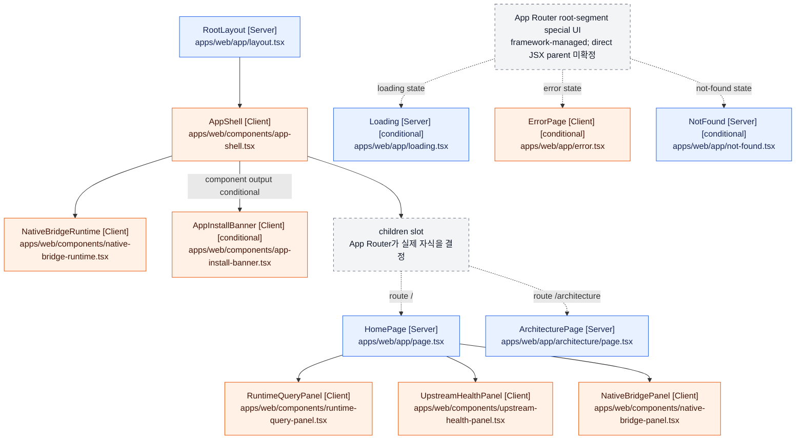

# apps/web React component tree

이 문서는 `apps/web/app/layout.tsx`의 `RootLayout`을 시작점으로, Next.js App Router가 구성하는 정적 React 컴포넌트 관계를 정리한다. CodeGraph의 symbol/call-path 탐색 결과를 기준으로 `apps/web/app`의 UI special file과 `apps/web/components`의 JSX 사용 위치를 교차 확인했다.

## 표기 규칙과 범위

- `[Server]`: `"use client"` 지시문이 없는 Server Component
- `[Client]`: `"use client"` 지시문이 있는 Client Component
- `[conditional]`: 컴포넌트 자체가 조건에 따라 `null`을 반환하거나 App Router가 런타임 상태에 따라 선택하는 UI
- `[dynamic]`: `next/dynamic`, `React.lazy`, `lazy()` 또는 동적 `import()`로 로드되는 컴포넌트
- `[slot: ...]`: `children`, slot, provider처럼 소스만으로 실제 자식을 하나로 확정할 수 없는 관계
- `div`, `section`, `main`, `header` 등의 intrinsic HTML element는 제외했다.
- `next/link`의 `Link`처럼 프로젝트 외부에서 정의된 컴포넌트도 제외했다.
- 조사 범위에서 `[dynamic]`에 해당하는 컴포넌트는 확인되지 않았다.
- 조건부로 렌더링되는 intrinsic element는 트리에 나타내지 않는다. 프로젝트 정의 컴포넌트 호출 자체가 조건식 안에 있는 경우도 확인되지 않았다.

## Route `/`

`RootLayout`의 `children`은 App Router가 현재 route segment에 맞게 제공한다. 이 route에서는 `HomePage`로 확정된다. `AppShell`은 `children`의 구체 타입을 알지 못하고 전달받아 렌더링한다.

```text
RootLayout [Server] (apps/web/app/layout.tsx)
└── AppShell [Client] (apps/web/components/app-shell.tsx)
    ├── NativeBridgeRuntime [Client] (apps/web/components/native-bridge-runtime.tsx)
    ├── AppInstallBanner [Client] [conditional] (apps/web/components/app-install-banner.tsx)
    │   └── 조건: store URL이 없으면 null 반환
    └── children [slot: App Router가 route child를 제공]
        └── HomePage [Server] (apps/web/app/page.tsx)
            ├── RuntimeQueryPanel [Client] (apps/web/components/runtime-query-panel.tsx)
            ├── UpstreamHealthPanel [Client] (apps/web/components/upstream-health-panel.tsx)
            └── NativeBridgePanel [Client] (apps/web/components/native-bridge-panel.tsx)
```

`RuntimeQueryPanel`, `UpstreamHealthPanel`, `NativeBridgePanel` 내부에는 조건부 UI가 있지만 모두 intrinsic HTML element이므로 이 컴포넌트 트리에는 별도 자식으로 표시하지 않는다.

## Route `/architecture`

`/architecture`에는 별도의 nested layout이 없다. 따라서 root layout의 `children`이 바로 `ArchitecturePage`로 결정된다.

```text
RootLayout [Server] (apps/web/app/layout.tsx)
└── AppShell [Client] (apps/web/components/app-shell.tsx)
    ├── NativeBridgeRuntime [Client] (apps/web/components/native-bridge-runtime.tsx)
    ├── AppInstallBanner [Client] [conditional] (apps/web/components/app-install-banner.tsx)
    │   └── 조건: store URL이 없으면 null 반환
    └── children [slot: App Router가 route child를 제공]
        └── ArchitecturePage [Server] (apps/web/app/architecture/page.tsx)
```

`ArchitecturePage`는 프로젝트에서 정의한 다른 React 컴포넌트를 렌더링하지 않는다.

## App Router special UI

다음 파일은 일반 route page가 아니라 root app segment에 연결된 App Router special file이다. 어떤 boundary와 runtime 상태에서 실제로 선택되는지는 Next.js가 관리하며, 프로젝트 소스에는 이들을 `RootLayout`이나 `AppShell`이 직접 JSX 자식으로 호출하는 관계가 없다. 따라서 아래 항목은 직접 부모를 추정하지 않고 독립된 framework-managed branch로 표시한다.

```text
Loading [Server] [conditional: loading state]
(apps/web/app/loading.tsx)

ErrorPage [Client] [conditional: uncaught route error]
(apps/web/app/error.tsx)

NotFound [Server] [conditional: unmatched route 또는 notFound()]
(apps/web/app/not-found.tsx)
```

세 special component 모두 프로젝트에서 정의한 다른 React 컴포넌트를 렌더링하지 않는다.

## 전체 component dependency graph

실선은 소스에 직접 나타나는 프로젝트 컴포넌트 렌더링 관계다. 점선은 App Router 또는 `children` slot이 런타임에 결정하는 관계다. `AppInstallBanner` 호출은 직접 관계지만, 컴포넌트 자체의 출력이 조건부이므로 edge label에 이를 표시했다.


